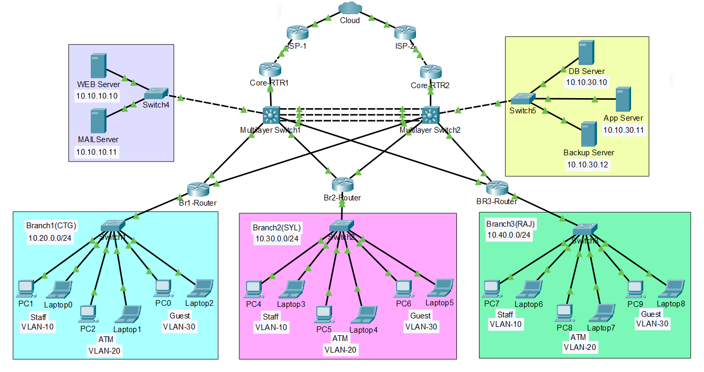

# Bank Branch Network


A multi-branch bank network designed and simulated in **Cisco Packet Tracer**. It has a Head Office (HQ) with dual ISP failover, a DMZ, a server network, and three branches (Chittagong, Sylhet, Rajshahi), each segmented into Staff, ATM and Guest VLANs.

---

## Topology

| Item | Details |
|------|---------|
| Tool | Cisco Packet Tracer |
| Topology file | [`Topology.pkt`](Bank_Branch_Network.pkt) |
| Screenshots | [`Screenshots`](Screenshots/Network-Topology.png) |



---

### Topology Summary

- **Internet edge:** ISP-1 and ISP-2 connect to the edge routers (Core-RTR1 and Core-RTR2) for dual ISP failover.
- **Core layer:** Two multilayer switches (SW1 and SW2) are joined by an EtherChannel (Port-Channel1). HSRP provides a virtual gateway (10.10.0.1).
- **DMZ:** Web and Mail servers are placed behind Switch4.
- **Server network:** DB, App and Backup servers are placed behind Switch5.
- **Branches:** Each branch has one router and one switch, with Staff, ATM and Guest VLANs.

---

## IP Address Plan

| Network | Subnet |
|---------|--------|
| HQ LAN | 10.10.0.0/24 |
| DMZ | 10.10.10.0/24 |
| Server Network | 10.10.30.0/24 |
| Branch 1 (Chittagong) | 10.20.0.0/24 |
| Branch 2 (Sylhet) | 10.30.0.0/24 |
| Branch 3 (Rajshahi) | 10.40.0.0/24 |
| Core link SW1 <-> SW2 | 10.0.0.8/30
| ISP-1 link | 203.0.113.1/30 |
| ISP-2 link | 203.0.113.5/30 |
| HSRP Virtual IP | 10.10.0.1 |

### Servers

| Zone | Server | IP |
|------|--------|----|
| DMZ | Web Server | 10.10.10.10 |
| DMZ | Mail Server | 10.10.10.11 |
| Server Network | DB Server | 10.10.30.10 |
| Server Network | App Server | 10.10.30.11 |
| Server Network | Backup Server | 10.10.30.12 |

### Branch VLANs

| VLAN | Name | Branch 1 (CTG) | Branch 2 (SYL) | Branch 3 (RAJ) |
|------|------|----------------|----------------|----------------|
| 10 | Staff | 10.20.10.0/24 | 10.30.10.0/24 | 10.40.10.0/24 |
| 20 | ATM | 10.20.20.0/24 | 10.30.20.0/24 | 10.40.20.0/24 |
| 30 | Guest | 10.20.30.0/24 | 10.30.30.0/24 | 10.40.30.0/24 |

---
## Network Devices

| Device | Role | Location |
|--------|------|----------|
| ISP-1, ISP-2 | Internet service providers | Internet edge |
| R1 (Edge-1 / Core-RTR1) | Edge router, HSRP, NAT | HQ |
| R2 (Edge-2 / Core-RTR2) | Edge router, HSRP, NAT | HQ |
| SW1 (Multilayer Switch1) | Core switch | HQ |
| SW2 (Multilayer Switch2) | Core switch | HQ |
| Switch4 | DMZ access switch | HQ |
| Switch5 | Server network access switch | HQ |
| R3 (Br1-Router) | Branch router | Chittagong |
| SW-BR1 (Switch1) | Branch access switch | Chittagong |
| R4 (Br2-Router) | Branch router | Sylhet |
| SW-BR2 (Switch2) | Branch access switch | Sylhet |
| R5 (BR3-Router) | Branch router | Rajshahi |
| SW-BR3 (Switch3) | Branch access switch | Rajshahi |
| Web, Mail, DB, App, Backup servers | Servers | HQ |
| PCs and laptops | End devices (Staff, ATM, Guest) | Branches |

---

## Configuration Documentation

Device configurations are stored in the [`Configurations/`](Configurations/) folder.

| Folder | Contents |
|--------|----------|
| [`Configurations/HQ/`](Configurations/HQ/) | Core routers and Core switches |
| [`Configurations/Branches/`](Configurations/Branches/) | Branch routers and switches (Chittagong, Sylhet, Rajshahi) |
| [`Configurations/Servers/`](Configurations/Servers/) | DMZ and server network settings |


## Features

- Dual ISP with Failover
- OSPF Routing
- HSRP (Redundancy)
- NAT (Internet Access)
- VLAN Segmentation
- ACL (Security Policies)
- EtherChannel (Link Aggregation)
- DHCP (Auto IP)

## Technologies Used

- Cisco Packet Tracer
- OSPFv2
- HSRP
- NAT/PAT
- VLAN & Trunking
- ACL
- EtherChannel
  

---

## Project Structure

```
Bank-Branch-Network/
│
├── Configurations/
├── Screenshots/
├──Bank_Branch_Network.pkt/
├── README.md
│
│
├── Configurations/
│   ├── HQ/
│   │   ├── Multilayer-Switch1.md
│   │   ├── Multilayer-Switch2.md
│   │   ├── Core-Router1.md
│   │   └── Core-Router2.md
│   │
│   ├── Branches/
│   │   ├── CTG/
│   │   │   ├── Branch1-Router.md
│   │   │   └── Switch1.md
│   │   │
│   │   ├── SYL/
│   │   │   ├── Branch2-Router.md
│   │   │   └── Switch2.md
│   │   │
│   │   └── RAJ/
│   │       ├── Branch3-Router.md
│   │       └── Switch3.md
│   │
│   └── Servers/
│       ├── Web-Server.md
│       ├── Mail-Server.md
│       ├── DB-Server.md
│       ├── App-Server.md
│       └── Backup-Server.md
END
```

| File / Folder | Description |
|---------------|-------------|
| `README.md` | Project documentation |
| `Bank_Branch_Network.pkt` | Cisco Packet Tracer topology file |
| `Configurations/` | Device configuration files |
| `Documentation/` | Reports and extra documents |
| `Screenshots/` | Topology and test screenshots |

## How to Use

1. Clone the repository
   ```bash
   git clone https://github.com/salman7912/Professional-networking-portfolio/Bank_Branch_Network.git
   ```
2. Open `Bank_Branch_Network.pkt` with Cisco Packet Tracer.
3. Check the device configurations in the `Configurations/` folder.
4. Test connectivity with `ping` and `tracert` between branches, HQ and servers.

## 👤 Author

**Md. Salman Farsi** - [GitHub](https://github.com/salman7912/Professional-networking-portfolio)

## Project Status

In Progress
