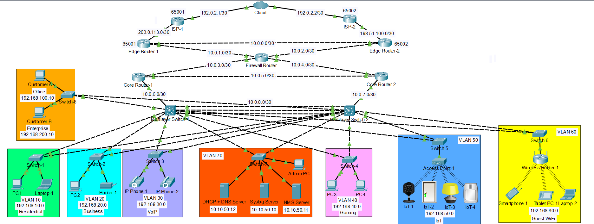

# Edge Network with Multi-Homing and Customer Segmentation

A Cisco Packet Tracer lab of a dual-ISP service-provider edge. Two ISPs connect over eBGP to two edge routers, traffic passes a firewall router into a routed core, and two multilayer switches provide HSRP gateways for eight segmented VLANs (residential, business, VoIP, gaming, IoT, guest, servers and two customer networks). Access between segments is controlled with per-VLAN extended ACLs.



## Goals

- Connect one network to two ISPs so that the loss of one ISP does not take the network offline.
- Share outbound traffic across both edges (ECMP) instead of leaving one link idle.
- Keep the default gateway available when one multilayer switch fails (HSRP, split active roles).
- Segment residential, business, VoIP, gaming, IoT, guest and customer traffic, and block traffic between segments.
- Protect the server VLAN, so users reach only DHCP and DNS there.
- Collect logs and SNMP data centrally, and restrict device management to one Admin PC.

## Architecture

```
            ISP-1 (AS100) ---- Cloud ---- ISP-2 (AS200)
                |                              |
        Edge-Router-1 (AS65001) -- eBGP -- Edge-Router-2 (AS65002)
                \                              /
                 +------ Firewall-Router ------+
                         /            \
                Core-Router-1 ---- Core-Router-2
                      |                  |
                    MLS-1 == Po1 (LACP) == MLS-2
                      \  HSRP gateways   /
             Access Switch 1-6   Servers switch   Customer switch
```

| Layer | Devices | Role |
|-------|---------|------|
| Internet | ISP-1 (AS 100), ISP-2 (AS 200) | Provider routers, loopbacks 8.8.8.8 and 1.1.1.1 used as test targets |
| Edge | Edge-Router-1 (AS 65001), Edge-Router-2 (AS 65002) | eBGP to the ISPs, NAT/PAT, default route into OSPF, anti-spoofing ACL |
| Firewall | Firewall-Router | Inbound ACL `FROM-EDGE` between the edges and the core |
| Core | Core-Router-1, Core-Router-2 | Routed core, one per MLS |
| Distribution | MLS-1, MLS-2 | Inter-VLAN routing, HSRP, Rapid-PVST, per-VLAN ACLs, DHCP relay |
| Access | Switch-1 to Switch-6, Servers switch, Customer switch | User, server and customer ports |

## Routing design

**BGP.** ISP-1 (AS 100) peers with Edge-Router-1 (AS 65001), ISP-2 (AS 200) peers with Edge-Router-2 (AS 65002), the two ISPs peer with each other, and the two edges peer with each other. Each ISP advertises a default route and a loopback used as an Internet test address.

**OSPF (area 0).** The edge routers, the firewall, both core routers and both MLS switches run OSPF. Each edge router originates a default route with `default-information originate`, and VLAN interfaces are passive.

**ECMP.** Both edge routers originate an equal-cost external default route (metric 1, type E2). The Firewall-Router installs two next hops (10.0.1.1 and 10.0.2.1) when the cost to both edges is equal, so there is no per-interface `ip ospf cost` on the firewall. CEF is disabled in the lab, so traffic is shared per destination.

**NAT/PAT.** Both edges translate internal sources (192.168.0.0/16 and 10.0.0.0/8) to the address on their ISP-facing interface. Traffic to 8.8.8.8 leaves through Edge-Router-1, and traffic to 1.1.1.1 through Edge-Router-2.

## Layer 2 and gateway design

- **HSRP per VLAN, split roles.** MLS-1 is active for VLAN 10, 30, 50, 70 and 100. MLS-2 is active for VLAN 20, 40, 60 and 200. Both switches use `preempt`.
- **Rapid-PVST.** The STP root for each VLAN is the same switch as the HSRP active gateway (priority 4096 on the active switch, 8192 on the other).
- **EtherChannel.** Fa0/20 to Fa0/22 form a LACP Port-channel 1 between MLS-1 and MLS-2. It is a routed link (10.0.8.0/30) that carries OSPF as a backup path.
- **VTP transparent** on the multilayer and access switches, VLANs defined locally.
- **Customer switch** carries VLAN 100 (Customer A) and VLAN 200 (Customer B) over trunks to both MLS switches. Trunks allow only VLAN 100 and 200, and customer ports use PortFast with BPDU guard.
- **HSRP does not track the routed uplinks.** Losing the uplink on MLS-1 does not move the HSRP role. Traffic is rerouted by OSPF through Port-channel 1 instead.

## Addressing and VLAN plan

| VLAN | Name | Network | HSRP gateway | HSRP active | ACL (inbound) |
|------|------|---------|--------------|-------------|---------------|
| 10 | Residential | 192.168.10.0/24 | 192.168.10.1 | MLS-1 | RES-IN |
| 20 | Business | 192.168.20.0/24 | 192.168.20.1 | MLS-2 | BIZ-IN |
| 30 | VoIP | 192.168.30.0/24 | 192.168.30.1 | MLS-1 | VOIP-IN |
| 40 | Gaming | 192.168.40.0/24 | 192.168.40.1 | MLS-2 | GAME-IN |
| 50 | IoT | 192.168.50.0/24 | 192.168.50.1 | MLS-1 | IOT-IN |
| 60 | Guest-WiFi | 192.168.60.0/24 | 192.168.60.1 | MLS-2 | GUEST-IN |
| 70 | Servers-Mgmt | 10.10.50.0/24 | 10.10.50.1 | MLS-1 | SERVER-IN |
| 100 | Customer-A | 192.168.100.0/24 | 192.168.100.1 | MLS-1 | CUSTA-IN |
| 200 | Customer-B | 192.168.200.0/24 | 192.168.200.1 | MLS-2 | CUSTB-IN |

| Server | Address | Purpose |
|--------|---------|---------|
| DHCP + DNS | 10.10.50.12 | DHCP pools for every user VLAN, DNS |
| Syslog | 10.10.50.10 | Central log collection |
| NMS | 10.10.50.11 | SNMP monitoring |
| Admin PC | 10.10.50.20 | The only host allowed to manage devices |
| Servers switch | 10.10.50.27 | Management address |

Point-to-point links, router IDs and DHCP pools are listed in [Docs/IP_Addressing.md](Docs/IP_Addressing.md).

## Security design

### Segment access policy

Every VLAN interface has an inbound extended ACL, so traffic is filtered at the first Layer 3 hop. Each ACL permits only the host's own subnet as a source (anti-spoofing) and denies the private ranges 10.0.0.0/8, 172.16.0.0/12 and 192.168.0.0/16 before it permits the Internet.

| Source | Internet | DHCP, DNS | Ping DNS server | Other VLANs | Other servers | Managed by Admin PC and NMS |
|--------|----------|-----------|-----------------|-------------|---------------|-----------------------------|
| VLAN 10, 20, 30, 40 | Allowed | Allowed | Allowed | Blocked | Blocked | Yes |
| VLAN 50 IoT | Allowed | Allowed | Blocked | Blocked | Blocked | Yes |
| VLAN 60 Guest | Allowed | Allowed | Blocked | Blocked | Blocked | No |
| VLAN 100 Customer A | Allowed | Allowed | Blocked | Blocked | Blocked | No |
| VLAN 200 Customer B | Allowed | Allowed | Blocked | Blocked | Blocked | No |

- **Managed by Admin PC and NMS** means the ACL lets replies from that VLAN reach 10.10.50.20 and 10.10.50.11 (ping replies, established TCP, SNMP). Guest and customer VLANs are intentionally unreachable from management hosts.
- The server VLAN ACL `SERVER-IN` allows DHCP and DNS replies, SNMP and ping from the NMS, all traffic from the Admin PC, and the HSRP hello (`udp 224.0.0.2 eq 1985`). Without the HSRP line both switches become active for VLAN 70.
- Customer VLANs are Internet-only. This matches how a provider treats customer networks: it does not log in to them through the customer data VLAN.

The complete ACL set with a rollback block is in [Configs/MLS-ACL.txt](Configs/MLS-ACL.txt).

### Edge and firewall

- **ANTI-SPOOF** (inbound on each ISP-facing interface): permits BGP, then drops sources in 10.0.0.0/8, 172.16.0.0/12, 192.168.0.0/16, 127.0.0.0/8, 169.254.0.0/16 and 0.0.0.0/8, and drops ICMP echo from the Internet.
- **FROM-EDGE** (inbound on the Firewall-Router from each edge): permits OSPF, established TCP, ICMP replies, DNS replies, Syslog to 10.10.50.10 and SNMP replies to the NMS, and denies everything else.

## Services: DHCP, DNS, Syslog, SNMP

- **DHCP and DNS** run on one server (10.10.50.12). Each VLAN has a pool (gateway `.1`, DNS 10.10.50.12, start address `.10`) for VLAN 10 to 60, Customer A and Customer B. The VLAN interfaces use `ip helper-address 10.10.50.12`.
- **Syslog** from the routers and switches goes to 10.10.50.10 (`logging 10.10.50.10`, with timestamps).
- **SNMP** uses a read-only community, polled by the NMS at 10.10.50.11.

## Management access

SSH version 2 is used with a local account, a domain name, an RSA key and a VTY ACL that permits only the Admin PC:

```
ip domain-name lab.local
username admin secret <ADMIN_PASSWORD>
crypto key generate rsa general-keys modulus 1024
ip ssh version 2
access-list 99 permit host 10.10.50.20
line vty 0 4
 login local
 access-class 99 in
 transport input ssh
```

Telnet is not used. Passwords in this repository are replaced with placeholders.

## Verification

Results are tracked in [Docs/Test_Plan.md](Docs/Test_Plan.md), and every command is listed in [Docs/Verification_Commands.md](Docs/Verification_Commands.md). Evidence is stored under [Screenshots/](Screenshots/).

| Area | Status |
|------|--------|
| PC1 reaches 8.8.8.8 and 1.1.1.1 | Pass |
| ACL counters show blocked inter-VLAN and private-range traffic | Pass |
| Customer A gets DHCP and reaches the Internet | Pass |
| HSRP, STP root, EtherChannel, OSPF neighbors | Pass |
| ECMP (two next hops, NAT on both edges) | Re-check after the latest firewall change |
| Customer B, Guest, IoT policy tests | Pending |
| Failover (HSRP, uplink loss, ISP loss) | Pending |

### Failover tests

| Test | Action | Expected |
|------|--------|----------|
| HSRP | Shut `interface vlan 10` on MLS-1 | MLS-2 becomes active for VLAN 10 and PC1 still reaches 8.8.8.8 |
| Uplink loss | Shut Fa0/7 on MLS-1 | HSRP roles stay the same, OSPF reroutes through Port-channel 1 and Core-Router-2 |
| ISP loss | Shut Fa0/0 on Edge-Router-1 | Traffic leaves through Edge-Router-2 and ISP-2 |

## Packet Tracer limitations

| Limitation | Workaround used |
|------------|-----------------|
| No stateful firewall | ACLs use `established` and ICMP reply lines to allow return traffic |
| `log` keyword rejects the whole ACL line | `log` is not used |
| `logging trap`, `snmp-server host ... version 2c` are not accepted | Default logging level and a read-only community |
| `transport input ssh telnet` is not accepted | `transport input ssh` after the SSH test |
| `show running-config interface vlan N` is not accepted | `show ip interface vlan N` |
| Configuration reverts on reopening the `.pkt` | `write memory` and Packet Tracer save (Ctrl+S) |


## How to run the lab

1. Install Cisco Packet Tracer and open `Topology/Edge-Network.pkt`.
2. Wait about 30 seconds for OSPF, BGP and HSRP to converge.
3. Set PCs to DHCP and run `ping 8.8.8.8` and `ping 1.1.1.1`.
4. Follow [Docs/Test_Plan.md](Docs/Test_Plan.md) and [Docs/Verification_Commands.md](Docs/Verification_Commands.md).
5. Save with `write memory` and Ctrl+S after any change.

## Repository layout

```
edge-network-multihoming-segmentation/
├── README.md
├── Topology/
│   ├── Edge-Network.pkt        
│   ├── README.md
│
├── Diagrams/
│   └── ISP_Edge_Network_Infographic.png
│   └── Network-Topology.png

├── Configs/
│   ├── ISP-1.txt
│   ├── ISP-2.txt
│   ├── Edge-Router-1.txt
│   ├── Edge-Router-2.txt
│   ├── Firewall-Router.txt
│   ├── Core-Router-1.txt
│   ├── Core-Router-2.txt
│   ├── MLS-1.txt
│   ├── MLS-2.txt
│   ├── MLS-ACL.txt
│   ├── Access-Switches.txt       (Switch-1..6)
│   ├── Servers-Switch.txt        (Switch-7, SSH)
│   └── Customer-Switch.txt
│
├── Docs/
│   ├── IP_Addressing.md
│   ├── Test_Plan.md
│   └── Verification_Commands.md
│
└── Screenshots/
    ├── ping-tests/
    ├── acl-matches/
    └── ospf-bgp-hsrp/
```

## Technologies

Cisco Packet Tracer, eBGP, OSPF, ECMP, HSRP, Rapid-PVST, LACP EtherChannel, NAT/PAT, VLAN and trunking, extended ACLs, DHCP relay, DNS, Syslog, SNMP, SSH

## 👤 Author

**Md. Salman Farsi** - [GitHub](https://github.com/salman7912/Professional-networking-portfolio)

## Project Status

In Progress

