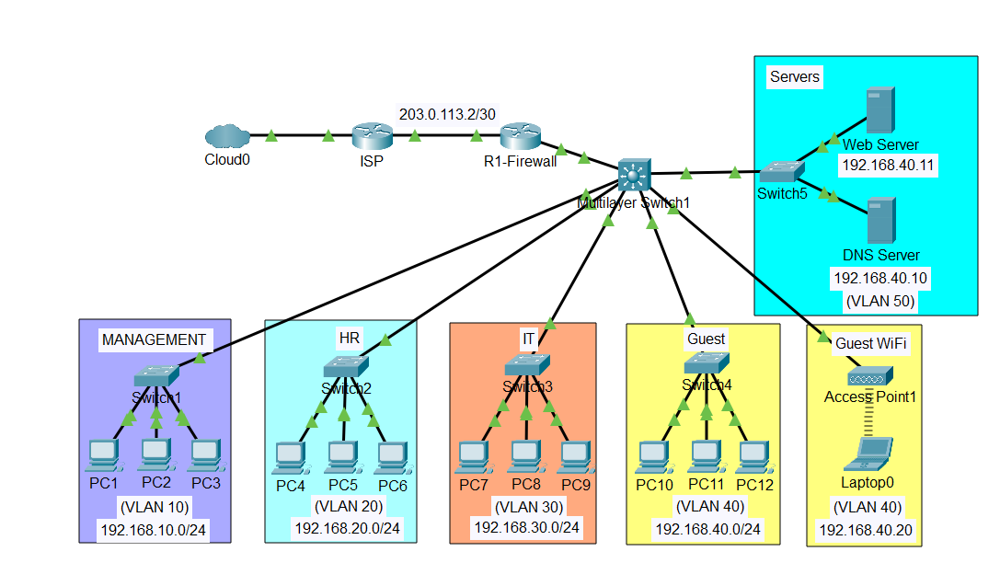

# Small Business Enterprise Network

## Project Overview

This project demonstrates the design and implementation of a small business enterprise network using Cisco Packet Tracer.

The network is designed to provide structured connectivity for multiple departments, centralized server services, guest wireless access, and external ISP connectivity.

The infrastructure uses VLAN segmentation, a multilayer switch, access switches, a firewall, and dedicated Web and DNS servers.

## Network Topology

## Network Design

| Department | VLAN | Network |
|---|---:|---|
| Management | 10 | 192.168.10.0/24 |
| HR | 20 | 192.168.20.0/24 |
| IT | 30 | 192.168.30.0/24 |
| Guest | 40 | 192.168.40.0/24 |
| Guest WiFi | 40 | 192.168.40.0/24 |
| Servers | 50 | Addressing to be finalized |

## Network Devices

- ISP Router
- R1-Firewall
- Cisco Multilayer Switch
- Departmental Access Switches
- Wireless Access Point
- Web Server
- DNS Server
- End-user PCs and Wireless Laptop

## Technologies

- Cisco Packet Tracer
- VLAN Configuration
- Inter-VLAN Routing
- Layer 3 Switching
- Static Routing
- DHCP
- DNS and Web Services
- LAN/WAN Networking
- Wireless Networking
- Network Troubleshooting

## Project Objectives

- Implement departmental network segmentation.
- Configure VLANs and trunk links.
- Enable inter-VLAN routing.
- Configure DHCP for end-user networks.
- Establish ISP connectivity.
- Implement centralized Web and DNS services.
- Practice enterprise network configuration and troubleshooting.

## Configuration Documentation

Detailed Cisco IOS configurations and verification commands are documented in the `Configurations` directory.

## Project Files

- `Small_Business_Enterprise_Network.pkt` – Cisco Packet Tracer project file.
- `images/network-topology.png` – Network topology diagram.
- `Configurations/` – Router and switch configurations.

## Author

**Md. Salman Farsi**

Aspiring Network Engineer | IT Infrastructure

GitHub: https://github.com/salman7912

LinkedIn: https://linkedin.com/in/salman67912

## Project Status

In Progress
